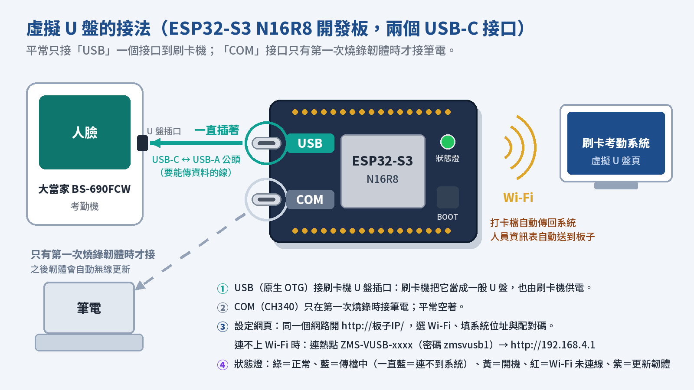
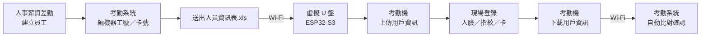

# 資料助秘刷卡考勤系統


大當家 **BS-690FCW** 四合一人臉／指紋／密碼／感應卡（IC 卡）考勤機的管理系統，用來**完全取代原廠的 U600 考勤軟體**，並且和
[資料助秘之一般公司人事薪資差勤](https://github.com/achir1015/zms-general-hr) **共用同一個 MariaDB 資料庫**：
員工直接用人事系統的員工，打卡寫進人事系統的打卡紀錄，出勤日報、月報與薪資計算直接使用。

- [主要功能](#主要功能)
- [安裝](#安裝windows-1011)
- [虛擬 U 盤：放置與接法](#虛擬-u-盤放置與接法)
- [虛擬 U 盤：設定](#虛擬-u-盤設定)
- [虛擬 U 盤：功能](#虛擬-u-盤功能)
- [人事薪資差勤的員工如何上傳到刷卡機](#人事薪資差勤的員工如何上傳到刷卡機)
- [打卡紀錄如何回到人事系統](#打卡紀錄如何回到人事系統)
- [燒錄虛擬 U 盤韌體](#燒錄虛擬-u-盤韌體第一次)

## 主要功能

| 功能 | 說明 |
|---|---|
| **虛擬 U 盤（免插拔）** | 一塊 ESP32-S3 長期插在考勤機的 U 盤插口，考勤機把它當成一般 U 盤；打卡檔經 Wi-Fi 自動傳回、匯入並存查，人員資訊表也能從系統自動送到考勤機 |
| **上傳到刷卡機** | 六個步驟把人事系統的員工送到考勤機，並以考勤機傳回的人員資訊表確認每個人是否已在機器上、是否已登錄人臉／指紋／卡 |
| **打卡匯入** | 讀考勤機匯出的 `AGL_001.TXT`／`GLG_001.TXT`（人臉、指紋、感應卡、密碼），依人事系統的班表自動判斷上班／下班（含跨夜班），寫進人事 `punches` |
| **不重複、可存查** | 同一個檔案只能匯入一次、同一筆刷卡不會重複；每次匯入的原始檔、送到考勤機的人員資訊表都原封不動另存一份 |
| **員工與卡號** | 機器工號（最多 8 位數字）、感應卡號（悠遊卡、一卡通等 IC 卡）；讀入考勤機的「人員資訊表.xls」可直接建立人事員工 |
| **隨身碟匯入** | 沒有虛擬 U 盤時，也能用一般隨身碟帶檔案 |
| **U600 搬移** | 從 U600 的 `tmkq.mdb` 一次搬來部門、員工、卡號與舊打卡紀錄（只讀，不改 U600） |
| **語音動態教學** | 11 課臺灣華語語音，步驟依旁白依序點亮；虛擬 U 盤的接法附雙接頭示意圖 |
| **版本更新** | 程式內檢查 GitHub Releases、下載後自動安裝並重新開啟；虛擬 U 盤的韌體也由系統無線更新 |

## 安裝（Windows 10／11）

1. 先安裝並設定好 [資料助秘之一般公司人事薪資差勤](https://github.com/achir1015/zms-general-hr)（本系統使用它內建的 MariaDB）。
2. 到 [Releases](https://github.com/achir1015/zms-attendance/releases/latest) 下載 `ZMSAttendance-Setup-<版本>.exe` 安裝，桌面會建立捷徑。
3. 開啟「資料助秘刷卡考勤系統」，用人事系統的帳號登入（需要「出勤管理」權限）。
4. 到「考勤機」頁新增考勤機（機號要和機器【通訊設置】的機號相同）。
5. 接好並設定虛擬 U 盤（下一節）。以前用過 U600 的，到「U600 搬移」一次搬入舊資料。

## 虛擬 U 盤：放置與接法



| 項目 | 說明 |
|---|---|
| 板子 | ESP32-S3 **N16R8**（16MB 快閃、8MB PSRAM），一側有兩個 USB-C 接口，分別印著 **USB** 與 **COM** |
| **USB 接口（原生 OTG）** | **一直插在考勤機的 U 盤插口**，用 USB-C ↔ USB-A 公頭、**能傳資料**的線（只能充電的線，考勤機會找不到 U 盤）。板子由考勤機供電 |
| **COM 接口（CH340）** | **只有第一次燒錄韌體時接筆電**，平常空著；之後的韌體由系統經 Wi-Fi 自動更新 |
| 放置位置 | 考勤機旁邊或背後皆可，只要收得到公司 Wi-Fi（2.4GHz） |
| 狀態燈 | 綠＝正常；藍閃＝傳檔中；一直藍＝Wi-Fi 已連上但連不到考勤系統；黃＝開機中；紅＝Wi-Fi 未連線；紫＝更新韌體中 |

## 虛擬 U 盤：設定

**系統端**（考勤系統「虛擬 U 盤」頁）：

1. 打開「接收服務」（預設埠 `8796`）。Windows 防火牆詢問時請允許「私人網路」。
2. 畫面會顯示這台電腦的 **位址**、**埠** 與 **配對碼**；只有配對碼正確的板子才能傳檔給系統。

**板子端**（任選一種）：

| 方式 | 做法 |
|---|---|
| 設定網頁（板子已連上網路） | 同一個網路的電腦或手機用瀏覽器開 `http://板子IP/`；也可以在「虛擬 U 盤」頁的板子卡片按「板子設定網頁」。修改設定時需輸入目前的配對碼 |
| 設定網頁（板子還沒有 Wi-Fi） | 手機連板子的熱點 `ZMS-VUSB-xxxx`（密碼 `zmsvusb1`），開 `http://192.168.4.1` |
| 設定.txt | 設定網頁存檔時會同步寫進 U 盤的 `設定.txt`；也可以把板子的 USB 接口暫時插到電腦，直接編輯這個檔案（Wi-Fi 密碼存好後會隱藏） |

設定網頁的欄位：Wi-Fi（可按「掃描」從清單選）、Wi-Fi 密碼、考勤系統電腦位址、埠、配對碼。儲存後板子自動重新連線，
約 20 秒內「虛擬 U 盤」頁就會出現它的卡片（上線狀態、剩餘空間、韌體版本、診斷資訊）。

## 虛擬 U 盤：功能

| 功能 | 說明 |
|---|---|
| 打卡檔自動傳回 | 考勤機【數據管理】→【導出新出入記錄】寫進虛擬 U 盤後，約十幾秒內經 Wi-Fi 傳回系統，自動匯入、依班表判斷上下班、寫進人事打卡 |
| 存查、不重複 | 每個傳回的原始檔都另存在 `存查\打卡紀錄`；同一個檔案只匯入一次 |
| 其他檔案 | 考勤機匯出的人員資訊表、指紋（`AFP_001.DAT`）、照片也會傳回並存查到 `存查\考勤機匯出`；**人員資訊表會自動比對員工**（卡號、人臉、指紋登錄狀態） |
| 送檔到考勤機 | 系統排入「待送出」的人員資訊表，板子約 15 秒內取走並放進 U 盤，考勤機【上傳用戶資訊】即可讀到 |
| 空間 | U 盤顯示為 FAT32 64MB（稀疏儲存，實際可存約 6MB）；檔案傳回後自動刪除，空間不會滿，頁面隨時看得到剩餘空間 |
| 韌體無線更新 | 系統內附的韌體（`firmware/`）比板子新時，板子會自己下載更新（狀態燈紫色），完成後自動重新開機 |
| 多台考勤機 | 每台考勤機各插一塊板子，每塊板子有自己的代號與對應機號，各自顯示狀態 |

## 人事薪資差勤的員工如何上傳到刷卡機

在考勤系統打開 **「上傳到刷卡機」** 頁，畫面會顯示每一步是否完成：

| 步驟 | 在哪裡做 | 做什麼 |
|---|---|---|
| ① 人事系統的員工 | 人事薪資差勤系統 | 建立員工（姓名、部門、到職日）。也可以讀入考勤機的人員資訊表直接建立 |
| ② 機器工號 | 考勤系統「上傳到刷卡機」 | 按「自動編機器工號」：人事工號是數字的沿用，不是的自動接續編號（最多 8 位數字） |
| ③ 感應卡（選用） | 考勤系統「員工與卡號」 | 輸入卡號（最多 10 位）；或之後在考勤機上感應 |
| ④ 送出人員資訊表 | 考勤系統「上傳到刷卡機」 | 「經虛擬 U 盤送出」或「存到隨身碟」；可選只送新增／變更的員工或全部。檔名 `人員資訊表.xls`，格式與考勤機範本相同，每次送出都存查到 `存查\人員資訊表` |
| ⑤ 在考勤機上操作 | 考勤機 | 點螢幕叫出選單 →【用戶管理】→【上傳用戶資訊】。人臉、指紋只能現場登錄：【用戶管理】→【用戶瀏覽】→ 選員工 → 編輯 → 面部／指紋；卡號沒輸入的按「卡」感應 |
| ⑥ 確認已在機器上 | 考勤機 | 【用戶管理】→【下載用戶資訊】，人員資訊表經虛擬 U 盤自動傳回，系統比對後在表格顯示每位員工「在機器上」與人臉／指紋登錄狀態，並帶回考勤機上感應的卡號 |



## 打卡紀錄如何回到人事系統

1. 考勤機【數據管理】→【導出新出入記錄】（或【導出全部出入記錄】）。
2. 虛擬 U 盤自動把 `AGL_001.TXT` 傳回系統；用隨身碟的，到「隨身碟匯入」頁匯入。
3. 系統依員工班表判斷上班／下班，寫進人事系統的打卡紀錄（來源標示人臉／指紋／卡／密碼）；
   對不到員工的紀錄先保留，補上機器工號後自動補寫。
4. 出勤日報、月報、補卡與薪資，在人事薪資差勤系統處理。

## 燒錄虛擬 U 盤韌體（第一次）

板子的 **COM** 接口接筆電（Arduino ESP32 core 3.3.x）：

```bash
arduino-cli compile -b "esp32:esp32:esp32s3:PSRAM=opi,FlashSize=16M,PartitionScheme=app3M_fat9M_16MB,USBMode=default,CDCOnBoot=default" esp32/vusb_esp32s3
```

```bash
arduino-cli upload -b "esp32:esp32:esp32s3:PSRAM=opi,FlashSize=16M,PartitionScheme=app3M_fat9M_16MB,USBMode=default,CDCOnBoot=default" -p COM3 esp32/vusb_esp32s3
```

燒好後拔掉 COM 線，把 **USB** 接口插到考勤機，再照「虛擬 U 盤：設定」完成設定。之後的版本由系統無線更新。

## 開發

```bash
python -m venv .venv
.venv\Scripts\pip install flet==1.1.2 flet-audio==1.1.2 pymysql openpyxl xlrd xlwt edge-tts pillow pytest pyinstaller
.venv\Scripts\python -m pytest -q tests        # 需要人事系統原始碼（ZMS_HR_SRC）與 MariaDB
.venv\Scripts\python tools\make_voice.py       # 產生語音教學 MP3
.venv\Scripts\python tools\make_guide_images.py  # 產生接法示意圖
.venv\Scripts\python tools\build_windows.py    # 產生安裝檔
```

考勤機的網路協定（埠 5005）沒有公開文件，原廠 U600 也無法以網路連線這一型機器，所以本系統以 U 盤（含虛擬 U 盤）交換資料。

---

系統開發：吳玉柱 先生 與 Claude AI Opus 5.5
